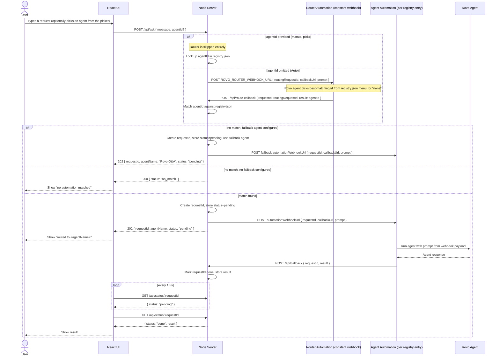

# Flow of Execution — PM Assistant POC

## Sequence diagram

## Step-by-step

1. **User submits a request** in the React UI. The composer has an agent picker (fed by `GET /api/agents`, which exposes only `id`/`name`/`description` from `registry.json`) defaulting to "Auto"; the user can instead pick a specific agent by name.
2. **UI calls the server**: `POST /api/ask` with `{ message, agentId }` — `agentId` is `null`/omitted for "Auto".
3. **Manual pick vs. routing**:
   - If `agentId` was provided, the server looks it up directly in `registry.json` and skips the router entirely (400 if the id doesn't exist). This is the "connectors"-style bypass — the user's choice always wins over the router.
   - Otherwise, the **server asks the router automation** to pick an agent: it builds a prompt listing every entry in `registry.json` (name, description, trigger examples) — excluding any `fallback: true` entry, since those are never offered as a router choice — generates its own internal `routingRequestId`, and POSTs to the constant `ROVO_ROUTER_WEBHOOK_URL` with that prompt and a `callbackUrl` pointing at `/api/route-callback`. The server then awaits that callback (with a timeout) before continuing.
4. **Router automation runs** (inside Jira/Confluence, only in the "Auto" path): a Rovo agent reads the prompt and decides on a single best-matching `id` (or `"none"`), then sends it back via outgoing webhook to `/api/route-callback` as `{ requestId: routingRequestId, result: "<id>" }`.
5. **No match** (only reachable via the "Auto" path):
   - If `registry.json` has an entry with `"fallback": true` (not offered to the router as a choice — filtered out of both the menu and the match lookup in step 4), the server uses it exactly like a normal match (step 6), so the request goes out to answer the question directly via Rovo instead of failing.
   - Otherwise, server responds `{ status: "no_match" }`, UI tells the user nothing fit.
6. **Match found** (or fallback used):
   a. Server generates a separate `requestId` (UUID) for the actual work and stores it as `pending`.
   b. Server calls that agent's `automationWebhookUrl` (from `registry.json`), sending `requestId`, a `callbackUrl` (this server's public `/api/callback`), and the user's message.
   c. Server immediately responds to the UI with `202 { requestId, agentName, status: "pending" }` — this is not synchronous, so the UI shows "routed to `<agentName>`" right away and starts polling.
7. **Agent automation rule runs** (inside Jira/Confluence, outside our code):
   a. Triggered by the incoming webhook.
   b. Runs the actual Rovo agent, passing the message through as its prompt.
   c. Sends an outgoing webhook back to `callbackUrl` with `{ requestId, result }`.
8. **Server receives the callback**: `POST /api/callback` marks that `requestId` as `done` and stores the result.
9. **UI polls** `GET /api/status/:requestId` every 1.5s. Once status flips to `done`, it renders the result and stops polling.

## Why it's async, not a direct call

Rovo agents have no public API a script can call and get a response from directly. The only reliable way to trigger one from outside Atlassian is via an Automation rule's incoming webhook — and automations don't block waiting for a caller, they run and then have to actively send their result somewhere. That's true for the router agent too, which is why `routeRequest()` internally fires-and-waits-for-a-callback instead of getting a response in the same HTTP round trip, the same fire → wait → callback pattern used for the actual agent run in steps 6–9. The UI only ever polls for the final result, not the routing step.

## Failure points worth knowing about

| Stage | Failure mode | What happens |
|---|---|---|
| Manual pick (step 3) | UI sends an `agentId` that doesn't exist in `registry.json` (stale picker cache, tampered request) | `/api/ask` returns `400`, router is never consulted |
| Routing (step 3–4, Auto only) | `ROVO_ROUTER_WEBHOOK_URL` unreachable/misconfigured, or the router automation never calls back within `ROVO_ROUTER_TIMEOUT_MS` | `/api/ask` returns `500`, UI shows the error, nothing gets triggered |
| Routing (step 4) | Router automation posts to the wrong `requestId`, or after the timeout already fired | `/api/route-callback` returns `404`, decision is silently lost, original `/api/ask` call eventually times out |
| Routing (step 5) | No agent matches well (router returns `"none"`) | `/api/ask` returns `status: "no_match"`, nothing gets triggered |
| Trigger (step 6b) | `automationWebhookUrl` unreachable/misconfigured | `/api/ask` returns `502`, request marked `error` in the store |
| Agent automation (step 7) | Automation rule itself fails or times out | Nothing calls `/api/callback` — request stays `pending` forever from the server's point of view; there's no timeout in this POC (add one before it's more than a demo) |
| Callback (step 8) | Automation posts to the wrong `requestId` | Server returns `404`, result is silently lost |

## Deployment note

In the Docker image, Express also serves the built UI from `client/dist`, so the browser and `/api` share one origin and the Vite dev proxy is not involved. The request flow above is otherwise unchanged. See the README's "Run with Docker" section.
